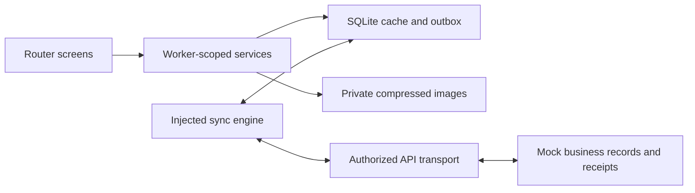

# Temporada — seasonal worker mobile app

Expo SDK 58, React Native 0.88.1/New Architecture and strict TypeScript. Workers sign in by phone, choose their identity on shared phones, confirm an exact terms version and submit compressed document images. SQLite records intent before transmission; the network delivers that durable intent later. Staff review remains separate from delivery.

English is the first-launch default, with an in-app Spanish toggle and a persisted choice. This is the user's explicit amendment to the original Spanish-first requirement.

## Worker experience

The redesigned app uses native system fonts, near-black headings, a warm palette and simple document lists. Home highlights the next meaningful action from actual terms and document state. Home, Documents and My Job are the primary destinations; terms review, capture and worker switching use contextual navigation.

Workers can review cached job details, confirm the displayed terms version offline, preview and save document photos, and distinguish work saved on the phone from delivery and staff review. Correction requests show the actual staff reason, with previous submissions available in collapsed history. Features remain gated by the existing configuration.

See the [eight-screen comparison and Android evidence](docs/evidence/ui-reference-reconciliation/README.md), [final polish and human TalkBack confirmation](docs/evidence/ui-final-polish/README.md), and [changed-file inventory](docs/ui-redesign-files.md). These redesign results are subsequent work, separate from the original assessment.

## Run locally

Prerequisites: Node 24.11.1 (`nvm use`), npm, Android Studio/SDK with a running AVD, and an Expo Go build compatible with SDK 58. Xcode/Simulator is needed for iOS. Native dependencies have been checked against the installed Expo SDK. Development/EAS binaries are configured but have not been built.

Install from the repository root:

```sh
npm ci
npm ci --prefix mock-server
```

Start the fictional backend in one terminal:

```sh
MOCK_ENABLE_CONTROLS=1 npm run mock:start
```

It binds to localhost:3000 and persists under `mock-server/.data`. Restarting does not reset terms, submissions or sessions. See [mock-server instructions](mock-server/README.md) for isolated fixtures, seed data and failure controls. Never delete a mobile database or pending images to reset a demo.

For Android, start an emulator in Android Studio Device Manager, then use another terminal:

```sh
adb reverse tcp:3000 tcp:3000
adb reverse tcp:8081 tcp:8081
EXPO_PUBLIC_API_URL=http://127.0.0.1:3000 EXPO_PUBLIC_ASSESSMENT_MODE=1 npx expo start --go --localhost --clear
```

Open the app from Expo's Android launcher. The direct Android-emulator host alternative is `http://10.0.2.2:3000`; localhost with ADB reverse was used for worker-flow verification. Reapply reverse mappings after an emulator/ADB restart.

For iOS, use the same running backend:

```sh
EXPO_PUBLIC_API_URL=http://127.0.0.1:3000 EXPO_PUBLIC_ASSESSMENT_MODE=1 npx expo start --go --ios --localhost --port 8082
```

The iOS follow-up used this launch pattern with an isolated backend on port 3009. Do not point an existing cache at an unrelated reset backend; use a separate disposable fixture without removing unresolved actions. Expo Go may need its matching SDK build; `--go` avoids selecting an uninstalled development client.

These commands are based on executed setup/launch evidence; a fresh-machine installation was not repeated during final documentation. If the shared npm cache is inaccessible, the previously used workaround is `npm ci --cache /private/tmp/seasonal-npm-cache`. Public configuration examples are in [.env.example](.env.example); `EXPO_PUBLIC_*` values are bundled and must never contain secrets.

## Fictional accounts

Use OTP **123456**. No real SMS is sent.

| Phone            | Worker / fresh seed                                                          |
| ---------------- | ---------------------------------------------------------------------------- |
| +52 55 1000 0001 | Ana López: v2 unconfirmed, no documents                                      |
| +52 55 1000 0002 | Bruno Díaz: v2 confirmed, passport Approved                                  |
| +52 55 1000 0002 | Carla Díaz: passport Correction Requested — `Foto borrosa, vuelva a tomarla` |

Assignment: JO-2026-0142, Valle Verde Farms, Yuma, Arizona, March 1–July 31, 2026. Required documents: passport, DS-160 confirmation and signed contract. Existing persistent fixtures may have advanced to v3 or contain later submissions.

## Offline behavior and architecture



Screens use hooks/services; domain/sync logic has no React/native/database imports. Repositories implement persistence contracts. Logout preserves pending intent and images; worker changes clear views and reject late results. Fresh authentication requires network; an existing saved session/cache can resume offline.

Pending Sync means local intent without an acknowledged delivery. Pending Review means server submission awaiting staff. Approved/Correction Requested require server review evidence. Refresh-known staff decisions survive older replay receipts. Stale terms require an explicit new confirmation. Transient errors use persisted backoff; 413/422 require a new corrected action, not blind retry. Background delivery is best effort; foreground/startup rebuild retry scheduling.

See [DECISIONS](DECISIONS.md), [data model](specs/data-model.md), [sync contract](docs/synchronization.md), [capture lifecycle](docs/capture.md) and [API contract](specs/api-contract.md).

## Failure controls and checks

With development controls enabled, the backend supports two-second latency, seeded random 500s, post-commit response loss, v3 publication, forced 413 and session expiry. Exact `curl` commands and submission-specific staff decisions are in [mock-server/README.md](mock-server/README.md#development-controls). Controls are loopback-only and disabled in production. The mock refuses production startup.

Previously executed quality commands:

```sh
npm run typecheck
npm run lint
npm run format:check
npm run arch:check
npm run test:ci
npm run expo:check
npm run config:check
npx expo-doctor
npx expo export --platform android
npx expo export --platform ios --output-dir /private/tmp/temporada-ios-export
```

The latest full redesign suite passed **161 tests** (59 Jest, 85 real SQLite/sync/file tests, 12 mock HTTP/storage tests and 5 architecture tests). Final arrow-weight polish then passed **34 affected UI/auth/navigation/accessibility tests**; it did not rerun the full domain suite. Typecheck, lint, formatting, architecture, Expo dependency/configuration checks and Android export passed. Expo Doctor previously passed 20/20 and was not rerun for final polish. See the dated evidence reports for which checks ran at each revision; saved assertions and historical passes do not constitute a new emulator run.

## Verification and remaining work

| Area                       | Recorded outcome                                                                                                                                                                                                        |
| -------------------------- | ----------------------------------------------------------------------------------------------------------------------------------------------------------------------------------------------------------------------- |
| Android redesign           | Eight reference comparisons at 393dp/100%; 360dp English/Spanish and 130% text checks, auth keyboards, navigation and capture; all six mandatory sync cases and touched offline/restart/review/switch journeys verified |
| Language/accessibility     | English default and persisted Spanish; large-text/focus checks passed. The user confirmed bilingual TalkBack listening; scope and unspecified device/version details are recorded in the final verification report      |
| Earlier iOS implementation | Sign-in, language switching, backend-outage restart/file recovery, terms, dropped response, 413 replacement and 500 recovery passed on iOS 26.5 **before the redesign**                                                 |
| Remaining iOS              | Redesigned screens have not been verified on iOS; earlier worker-switch, expired-session, airplane-mode, camera, 422/review-race and reboot gaps remain                                                                 |
| Release readiness          | Physical-camera quality, signed/EAS builds, store submissions, real backend integration and Android 9/2GB performance unverified                                                                                        |
| Submission evidence        | Original recordings A/B remain undocumented as complete; no recording or assessed-submission approval is claimed                                                                                                        |

[Original integration results](docs/evidence/offline-integration.md) retain their dated steps, screenshots and storage records. [Redesign evidence](docs/evidence/ui-redesign/README.md), [reference reconciliation](docs/evidence/ui-reference-reconciliation/README.md) and [final verification](docs/evidence/ui-final-polish/README.md) document the subsequent work. Earlier iOS results do not establish redesign compatibility. A historical Simulator camera attempt produced no image and was cancelled; gallery recovery worked.

The [coding ledger](docs/coding-ledger.md) preserves the original assessment endpoint of **299.91 minutes** and separately records subsequent redesign implementation and verification. The redesign must not be represented as part of that original timebox. [PROCESS](PROCESS.md), [release plan](docs/release-plan.md), [architecture answers](docs/architecture-answers.md) and [recording status](docs/recordings.md) provide the remaining handoff context.

Production requires HTTPS API/remote-flags URLs and separately approved `worker_authentication`, `worker_home_and_terms`, `worker_document_corrections` and `worker_document_capture` flags. Missing/invalid configuration fails closed; flags load at runtime creation, not continuously. Assessment mode requires `__DEV__` and is not a production bypass. No remote service is hosted by this repository.

GitHub Actions validates PRs/main; EAS development/preview/production profiles and a manual main-only build workflow exist. Credentials, protected environments, backend contract approval and rollout require authorized humans. OTA is not configured or published; native dependency changes require a compatible binary. No store or production approval is claimed.
