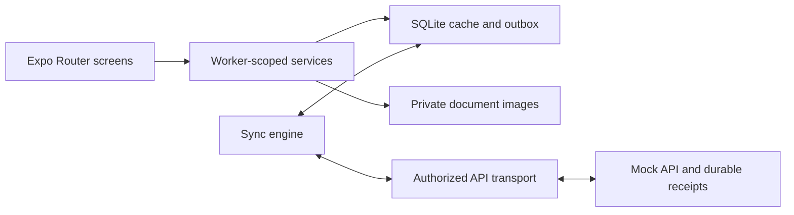

# Temporada

Temporada helps seasonal workers manage their job information, employment terms and required documents from their phone—even when connectivity is unreliable.

Workers can sign in with a phone number, choose their identity on a shared device, review their assignment and submit document photos. Work is saved on the phone before it is sent, with clear feedback about delivery, staff review and corrections.

## Assessment scope and timebox

The original assessment implementation and verification stopped at **299.91 minutes**, within the five-hour coding limit. The [cutoff snapshot (`6db6a09`)](https://github.com/Xheghun/Temporada/tree/6db6a0960a913c957a208a656dd9b57e0829ab23) preserves that application and its recorded limitations. The [coding ledger](docs/coding-ledger.md) records the cutoff and subsequent work separately.

**Current `main` includes additional work outside that timebox**, including the UI redesign. Later coding, fixes and verification must not be presented as part of the five-hour implementation. Use the cutoff snapshot to assess the original implementation; later versions are additional work for the assessor to consider at their discretion. Post-cutoff documentation was prepared separately, as permitted by the brief.

## Features

- **A clear next step:** Home highlights outstanding terms or documents and shows the current job at a glance.
- **Job and terms:** View employer, worksite and season dates, then confirm the exact terms version displayed. Updated terms require a new confirmation.
- **Document capture:** Take a photo or choose one from the gallery, preview it and save it for submission. Images are compressed and stored privately.
- **Offline support:** Saved confirmations and document photos survive app restarts, sign-out and worker switching. Synchronization resumes when connectivity and authentication allow it.
- **Shared phones:** Each authorized worker has a separate profile, documents and pending actions.
- **English and Spanish:** Spanish is the default; language choices are saved. The interface supports larger text and screen-reader controls.

Home, Documents and My Job are the main destinations. Terms review and photo capture open as focused flows with back navigation. Document history remains available without crowding the current submission.

## Projects Recordings

### AI Workflow Recordings

[Watch the AI workflow recording](https://github.com/Xheghun/Temporada/releases/download/project-recordings-2026-11-08/Temporada-AI-Workflow.mp4)

A walkthrough of the AI-assisted development workflow for Temporada.

### Scenarios and Code Walkthrough

[Watch the scenarios and code walkthrough](https://github.com/Xheghun/Temporada/releases/download/project-recordings-2026-11-08/Temporada-Scenarios-and-Code.mp4)

Demonstrates scenarios 2, 3 and 4, followed by discussion of code I am proud of and code I am less confident in. The scenarios segment plays at 1.7× speed; the code walkthrough retains its narration and original playback speed.

## How document status works

Saving, delivery and staff approval are separate steps:

| Status                    | Meaning                                                           |
| ------------------------- | ----------------------------------------------------------------- |
| Saved on this phone       | The photo is stored locally and waiting to send.                  |
| Sending / retry scheduled | Delivery is in progress or will be retried automatically.         |
| Sent / waiting for review | The server received the document; staff have not approved it yet. |
| Approved                  | Staff approved the submission.                                    |
| Correction requested      | A replacement is needed; the worker can read the staff reason.    |

A queued upload never counts as delivered, and delivery never implies approval. Previous submissions and review decisions are preserved when a replacement is submitted.

## Technology

Expo SDK 58, React Native 0.88.1 with the New Architecture, Expo Router and strict TypeScript. SQLite stores cached assignments and the durable outbox; private files hold document images; SecureStore holds authentication tokens. The repository includes a local mock API with fictional workers and persistent records.

## Run locally

You need Node 24.11.1 (`nvm use`), npm and an Expo Go build compatible with SDK 58. For Android, install Android Studio/SDK and start an emulator. For iOS, use Xcode and Simulator on macOS.

Install dependencies from the repository root:

```sh
npm ci
npm ci --prefix mock-server
```

Start the mock API in one terminal:

```sh
npm run mock:start
```

It listens on `localhost:3000` and persists records under `mock-server/.data`. Restarting the server preserves terms, submissions and sessions. See the [mock API guide](mock-server/README.md) for isolated fixtures and development controls. Keep an existing mobile cache paired with its backend data; deleting a database or pending images can discard unsent work.

### Android

With an emulator running, use another terminal:

```sh
adb reverse tcp:3000 tcp:3000
adb reverse tcp:8081 tcp:8081
EXPO_PUBLIC_API_URL=http://127.0.0.1:3000 EXPO_PUBLIC_ASSESSMENT_MODE=1 npx expo start --go --localhost --clear
```

Open the app using Expo's Android launcher. Reapply the reverse mappings after an emulator or ADB restart. The Android emulator can also reach the host API at `http://10.0.2.2:3000`.

### iOS

With the same backend running:

```sh
EXPO_PUBLIC_API_URL=http://127.0.0.1:3000 EXPO_PUBLIC_ASSESSMENT_MODE=1 npx expo start --go --ios --localhost --port 8082
```

`--go` selects Expo Go rather than a development client. `EXPO_PUBLIC_ASSESSMENT_MODE=1` enables the local demo features in development only. Public configuration examples are in [.env.example](.env.example); bundled `EXPO_PUBLIC_*` values must never contain secrets.

## Demo accounts

Use verification code **123456**. The mock API does not send real SMS.

| Phone            | Worker     | Initial state                         |
| ---------------- | ---------- | ------------------------------------- |
| +52 55 1000 0001 | Ana López  | Terms v2 unconfirmed; no documents    |
| +52 55 1000 0002 | Bruno Díaz | Terms v2 confirmed; passport approved |
| +52 55 1000 0002 | Carla Díaz | Passport correction requested         |

The shared number opens a worker picker for Bruno and Carla. Their assignment is with Valle Verde Farms in Yuma, Arizona, from March 1 to July 31, 2026. Required documents are a passport, DS-160 confirmation and signed contract. These are fictional seed records; a persistent backend may contain later terms or submissions.

## Architecture



Screens use hooks and services. Domain rules and synchronization logic are independent of React, native APIs and database implementations. Repositories implement persistence contracts.

Actions receive a stable identifier before transmission, and retries reuse it to prevent duplicate effects. Transient failures use persisted backoff. Upload-size and validation failures require worker correction. Newer staff decisions survive older delivery receipts, while worker ownership checks and session guards prevent data from appearing under another profile.

Fresh sign-in requires a network connection. A previously authenticated session can use cached information offline. Background synchronization is best effort; startup and foreground activity resume pending delivery.

## Development

Run the project checks from the repository root:

```sh
npm run typecheck
npm run lint
npm run format:check
npm run arch:check
npm run test:ci
npm run expo:check
npm run config:check
```

The test suite covers presentation, navigation, authorization, mock HTTP behavior and persistence/synchronization against real SQLite and files. GitHub Actions runs validation for pull requests and main.

To exercise slow connections, server errors, lost responses, changed terms or upload failures, start the mock with `MOCK_ENABLE_CONTROLS=1 npm run mock:start`. Available controls and requests are documented in the [mock API guide](mock-server/README.md#development-controls).

## Configuration and deployment

The included mock API is for local development. Production configuration requires HTTPS API and remote-feature-flag URLs. Authentication, job/terms, document review and capture are gated independently; missing or invalid configuration leaves them disabled. Development demo mode does not bypass production gates.

EAS development, preview and production profiles are configured. See the [release guide](docs/release-plan.md) for builds, environment setup and rollout. OTA updates are not configured; native dependency changes require a compatible app binary.

## Documentation

- [Architecture decisions](DECISIONS.md)
- [Data model](specs/data-model.md) and [API contract](specs/api-contract.md)
- [Synchronization](docs/synchronization.md) and [document capture lifecycle](docs/capture.md)
- [Mock API setup and controls](mock-server/README.md)

## Project timeline

The original core implementation and its recorded verification finished within the five-hour assessment limit, at 299.91 minutes. The [assessment snapshot](https://github.com/Xheghun/Temporada/tree/6db6a0960a913c957a208a656dd9b57e0829ab23) preserves that version.

I continued in my own free time afterward: preparing and refining the documentation, recording the AI workflow, demonstrating the scenarios and walking through code examples. The later UI redesign, Home compliance fixes and additional testing also happened outside the original timebox. The current project includes that subsequent work; the [coding ledger](docs/coding-ledger.md) separates it from the original assessment.

## Assessment use only

All rights reserved. This repository is provided solely for assessment and evaluation. The assessing team may inspect, run and test the project for that purpose. Reuse, redistribution, publication, or incorporation of any original code or materials into another project or product requires my express written permission. Submission for assessment does not transfer ownership or grant permission for any other use.

Third-party dependencies and materials remain subject to their respective licenses.
